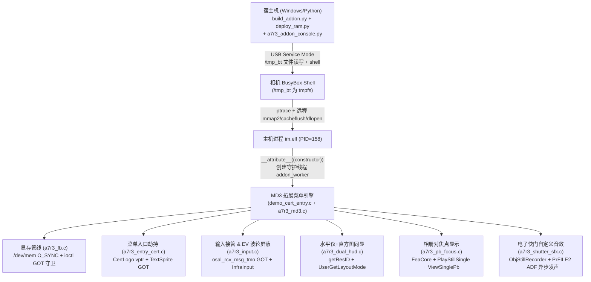

# 架构设计与实现思路 (Architecture & Design)

本文档系统整理 Sony ILCE-7RM3（α7R III，固件版本 **v3.10 / `CX62001_CN2`**）纯内存拓展菜单（`a7r3-ram-extension-menu`）的整体架构、注入流程、显存管线以及五大核心功能模块的实现思路。

---

## 1. 总体系统架构



### 纯 RAM 运行与安全边界

1. **存储零写入**：所有部署的 `.so`、远程辅助 ELF（`sdk_show_hex`、`sdk_mem_writer`、`sdk_mmap`、`sdk_cflush`、`sdk_dlopen`、`sdk_munmap`）、门控文件（`/tmp_bt/addon_arm`、`/tmp_bt/addon_open`、`/tmp_bt/addon_quit`）及日志（`/tmp_bt/addon.log`）全部落在 `/tmp_bt` `tmpfs`（部署时动态扩至 `16M`）。
2. **代码段零修改**：绝不覆盖只读 `.text` 指令，全部采用以下两种安全挂钩方式：
   - **GOT 原子替换**：替换目标动态库可写 `.got` 槽位（例如 `libObj.so`、`viewUnified2.so` 中的 PLT GOT）。
   - **C++ vtable 拷贝与 `vptr` 原子切换**：将只读虚表拷贝到静态可写数组，仅修改需要截获的槽位后，原子改写对象实例的 `vptr` 指针。
3. **禁止 `dlclose()` 与单调文件名策略**：
   - `im.elf` 中的输入或工作线程可能正阻塞于被钩住的函数（如 `osal_rcv_msg_tmo`）。卸载时先还原全部 GOT/vptr 槽位与显存，再向 `osal_rcv_msg_tmo` 投递唤醒，等待工作线程安全退出，但**绝不调用 `dlclose()`**（避免代码页被卸载导致仍在退栈的线程崩溃）。
   - 若同一开机周期内热更新，[deploy_ram.py](../tools/deploy_ram.py) 会扫描 `/proc/158/maps` 自动分配新名字（`addon_ram.so` → `addon_ram_2.so` → ...），确保每次 `dlopen` 均正常执行 `constructor`。

---

## 2. 远程纯 RAM 注入管线 (`deploy_ram.py` + `build_ram_tools.py`)

1. **唤醒 Service Terminal**：通过 `Sony-PMCA-RE` (`libusb`) 检测相机处于 MSC/Senser 模式后完成认证，激活 `SonySenserCamera.setTerminalEnable(True)`。
2. **获取基址与上传**：读取 `/proc/158/maps` 定位 `libc-2.11.2.so`（`LIBC_SVC_OFF = 0x00024F78`）与 `libdl-2.11.2.so`（`dlopen = 0x00000BC9`，`dlerror = 0x00000E05`）的基址；上传 `.so` 与内存读写辅助程序。
3. **远程分配可执行跳板页**：通过 `ptrace` 控制 `im.elf` 主线程在 `LIBC_SVC_OFF` 处执行 `sys_mmap2(0, 0x10000, RWX, MAP_PRIVATE|MAP_ANONYMOUS)`。
4. **写入 ARM `dlopen` 跳板并刷新 I-Cache**：`build_dlopen_stub_bytes()` 构造调用 `dlopen(path, RTLD_NOW)` + `dlerror()` 并触发陷阱指令的机器码，`sdk_mem_writer` 写入目标地址后，远程执行 `cacheflush(0xF0002)`（ARM Linux 私有系统调用）确保指令缓存一致性。
5. **执行 `dlopen` 与回收临时页**：`sdk_dlopen` 挂载后恢复被暂停线程的所有寄存器，随后远程 `munmap` 释放跳板页。`.so` 的 `demo_cert_ctor()` 立即验证 `a7r3_comm_is_im()`（确认为 `im.elf`）与门控文件，随后 `pthread_create` 拉起后台主循环 `addon_worker`。

---

## 3. 显存管线与 Material Design 3 界面 (`a7r3_fb.c` / `a7r3_draw.c` / `a7r3_md3.c`)

### 三缓冲物理布局与映射

A7R3 v3.10 显示子系统使用三块 `640×480`、`RGBA4444`（每像素 2 字节，共计 `614,400` 字节）的物理显存，必须通过 `a7r3_open("/dev/mem", O_RDWR | O_SYNC)` 打开并用 `mmap2` 映射（不带 `O_SYNC` 会因 ARM L1/L2 Cache 滞留导致花屏、条纹与缺块）：

| 物理地址 | 名称 | 内存排列 | 行方向 |
| --- | --- | --- | --- |
| `0x202E0200` | `render` | **8×8 Morton Z-order 分块** | **上下翻转 (`yy = 479 - y`)** |
| `0x23A80000` | `flipA` | 线性行优先 (`y * 640 + x`) | 正向自上而下 |
| `0x23B16000` | `flipB` | 线性行优先 (`y * 640 + x`) | 正向自上而下 |

- 渲染流程先在 `uint16_t g_canvas[640*480]` 上完成全线性绘图，再经 `a7r3_fb_pack_frame()` 一次性同时编码为 `g_pack_linear` 与 `g_pack_morton`（[a7r3_fb.h](../src/a7r3_fb.h) 的 `a7r3_morton_index()`），刷新时通过 `blit32`（每循环 16 字节 + `dsb`）写入三块显存。
- 菜单打开瞬间先用 `a7r3_fb_save_native()` 预打包原厂背景，关闭菜单时可在 `< 1 ms` 内无闪烁复原原生界面。

### 抗原生画面抢占（60 条带互质采样 + `ioctl` 守卫）

即使接管了输入，原生 GPU/OSD 线程在刷新指示图标时仍可能局部覆写显存。`a7r3_fb.c` 采用双重保护：
1. **互质步长条带抽检**：全屏分 60 条带，每带 32 点抽样，步长 `BAND_STEP = 79`（与每行 `320` 个 `uint32_t` 互质），避免漏检特定列宽度的横条，并辅以工作线程每 5 ms 轮询 2 个全带的 100% 逐字巡检。
2. **`ioctl` GOT 钩子 (`libObj + 0x0121cad0`)**：在原生图形提交/等待渲染 `ioctl` 前后立刻修复脏条带，彻底消除原生图标穿透闪烁。

### MD3 UI 与交互设计 (`demo_cert_entry.c`)

- **4-bit 抗锯齿汉字字模 (`md3_demo_labels.h`)**：通过 `tools/gen_md3_assets.py`（2× 超采样 LANCZOS 下采样并裁剪透明边距）将常用中文/ASCII 文案预渲染为 4-bit 透明通道掩码，运行时仅做 `0..15` alpha 混合即可渲染出高清平滑宋体/黑体文字。
- **4×4 超采样圆角与控件**：`a7r3_md3.c` 实现圆角矩形填充/描边、多层柔和阴影（Elevation Shadow）、圆形、胶囊线段及 52×32 MD3 Switch 开关。
- **紧凑顶栏主题下拉框**：`主题: [ 靛蓝 / 琥珀 / 青绿 ]` 不占用主卡片空间，支持触摸或方向键/确认键展开与收起。
- **左下角分页控件**：支持 `1 / 2` 与 `2 / 2` 切换；第 1 页承载 4 项功能（第 4 项进入自定义快门音效二级 MD3 页面），第 2 页预留为后续拓展功能位。

---

## 4. 原生菜单入口劫持 (`a7r3_entry_cert.c`)

- 相机「设置第 7 页」原生存在一个区域隐藏条目 **CertificationLogo (`procId = 0x10f`)**（原中文文案「认证标识」，资源 ID `0x0204ecba`）。
- **激活与劫持流程**：
  1. 定位 `viewUnified2.so` 中的 `CmnViewProcessDataMgr`（guard `0x00a48b0c` / inst `0x00a48b10`）以及 `CertificationLogo` 单例（getter `0x003ec7b9`，guard `0x00a6f380` / inst `0x00a6f384`，原 vtable `0x0088d850`）。
  2. 拷贝原虚表 30 个字到 `g_cert_vt_raw[]`，替换 3 个关键虚函数槽位：
     - `+0x38` (`GRAY`): 返回 `0`（永不置灰）
     - `+0x48` (`DIS`): 返回 `0`（解除隐藏，使其在设置第 7 页可见）
     - `+0x68` (`EXEC`): 触发 `g_exec_pending = 1` 打开 MD3 拓展菜单并返回 `1`
  3. 原子替换 `libObj.so` 的 `TextSprite::SetString(unsigned res_id)` GOT 槽位（`0x0121aa9c`）：当检测到资源 ID 为 `0x0204ecba`（主标题）时，改调 `TextSprite::SetString(const char *utf8)` 传入 `"拓展菜单"`；当检测到说明/确认 ID（`0x0204ecbb` / `0x0204ecbc`）时替换为 `"打开拓展功能菜单。"`。

---

## 5. 输入接管、外部事件退让与 EV 波轮屏蔽 (`a7r3_input.c`)

- 原子替换 `libObj.so` 中的 `osal_rcv_msg_tmo` GOT 槽位（`0x0121c8c0`），在消息投递给 `im.elf` 前完成分流与清洗：
  1. **队列分流**：区分实体按键队列 `QID_INPUT_MAIN (0x007a0020)` 与触摸队列 `QID_TP_MAIN (0x007b0026)`。触摸原始坐标读取 `libObj.so + 0x012d4ebc`（`InfraTp`）内嵌标定参数实时换算为 `0..639 × 0..479`。
  2. **SPSC 无锁环形队列**：吞并开启期间的导航键（上/下/左/右/确认/MENU）和触摸边沿放入环形队列供 `addon_worker` 消费，并调用 `osal_free_msg` 释放原始消息不透传给原厂 UI。
  3. **外部事件同步退让**：若在拓展菜单打开时接收到快门释放、模式转盘、回放切换等非导航实体按键，**在 `osal_rcv_msg_tmo` 返回前同步触发 `ext_dismiss_cb`**，立即关闭菜单、复原原生显存并取消按键吞并，随后将该外部事件原封不动归还给 `im.elf`。同时放行 EVF 接近传感器/翻转屏事件（`0x708b`/`0x708f`/`0x01d5`/`0x01d6`/`0x70ef`）确保自动切换屏幕不断裂，仅触发一次防冲突重绘。
  4. **曝光补偿波轮屏蔽**：拦截 `0x70d2` / `0x70d3` 事件，并在轮询查询函数 `get_phy`（GOT `0x0121c990`）与 `get_ev`（GOT `0x0121ac2c`）中以及 `InfraInput`（`0x012d4ee8`）缓存中强制返回状态 `0`，从源头阻断物理 EV 拨盘漂移或误触。

---

## 6. 水平仪与实时直方图同显 (`a7r3_dual_hud.c`)

原生状态下「电子水平仪」与「实时直方图」互斥（由 `viewUnified2.so` 的布局模式门控及外层布局资源决定）。为遵守零固件资源分发的合规原则，本仓库仅保留 C 语言钩子逻辑与可选头文件模板 `src/a7r3_dual_hud_payload.local.h.example`；当不存在本地提供的 `a7r3_dual_hud_payload.local.h` 时，该模块自动以安全透传模式编译并保留 `UserGetLayoutMode` 对相册 DISP 状态的监听。启用完整同显时由 4 个原子钩子协同工作：
1. **`libObj.so` `getResID` GOT (`0x0121a5c0`) + `RecDtor` GOT (`0x0121a51c`)**：当调用方来自 `ResourceLayoutParser`（`0x0059feca`）且读取水平仪外层布局资源 `RES_ID_LEVEL_OUTER (0x02008029)` 时，保存原对象首字并将之临时指向本地提供的 32 控件内联 `RecordPtr` 载荷 `g_dual_level_rec`（来自 `a7r3_dual_hud_payload.local.h`），使其同时声明水平仪与直方图控件；并在 `RecDtor` 析构前恢复原首字避免释放静态内存。
2. **`viewUnified2.so` `UserGetLayoutMode` GOT (`0x008cd0fc`) & 路由虚表槽 (`0x008602d4`)**：在 Gate 1 调用点（`0x001ae78c`）以及路由判定函数放行直方图控件 ID（`0xc96d8ddc`）映射至新主控容器（`0xd1153927`），实现同屏叠加且保留正常切换其他 DISP 模式的能力。

---

## 7. 相册回放显示对焦点 (`a7r3_pb_focus.c`)

1. **捕获 EXIF / MakerNote 数据**：
   - 拷贝并切换 `libmpr.so` `FeaCore` 虚表（`vptr` 偏移 `0x00a0af20`）的 `SendCallback` 槽位（`+7 / +0x1c`），同时钩住 `libObj.so` 的 `PlayStillSingle` GOT（`0x0121b818`）。
   - 为每张读取的单张回放照片分配一个 `4 × 128 KB` 环形缓冲区，接收 `CB_ID_PLAY_STILL_SINGLE (0x40000022)` / `CB_ID_READ_STILL_SINGLE (0x40000085)` 附带的 EXIF 数据块。
2. **机内 TIFF / Sony MakerNote 解析器**：定位 `II*\0` / `MM\0*` TIFF 头 → IFD0 Tag `0x0112`（旋转方向 `Orientation`）与 `0x8769`（ExifIFD）→ MakerNote Tag `0x927c` → `"SONY DSC \0\0\0"` → 解析 Sony 对焦坐标 Tag `0x2027`（图像全宽高与对焦点中心 `(fx, fy)`），结合横竖屏旋转变换精确映射到 `640×480` 屏坐标。
3. **精细显示状态机**：
   - 钩住 `viewUnified2.so` `ViewSinglePb` 的 `OPEN`/`CLOSE`/`EXIT`/`DTOR` 虚表槽及 `GetDispType` GOT（`0x008cc9d4`），结合全局状态字节（`VU2_CUR_PB_BASE_OFF`、`VU2_ENLARGE_OPEN_OFF`、`VU2_MOVIE_PB_OFF`、`VU2_GROUP_PB_STAT_OFF`、`VU2_CONT_PB_GRP_OFF`）。
   - 在 **连拍组外部缩略预览**、**放大状态**、**视频回放**、**DISP 直方图/详细信息视图** 以及 **按下 MENU 打开原厂菜单** 时自动隐藏；进入连拍组内部后重新显示当前照片对应对焦点。
   - **像素级无损叠框 (`a7r3_fb_pb_box_show/hide`)**：仅记录并替换红框外框 1~2px 边缘像素的原值（最多 640 个像素点），切换照片或退出回放时精确写回原像素，不破坏原生缩略图或图像内容。

---

## 8. 电子快门自定义快门音效 (`a7r3_shutter_sfx.c`)

该模块历经多轮实机调优，最终实现了**不拖慢原生 UI、线程安全、支持 SD 卡任意长文件名 WAV 实时解码编码、并且几乎零延迟异步发声**的完整音频管线：

```text
快门触发 (ObjStillRecorder::ParseRecCntInfoPinCommand @ libObj+0x0120615c)
  │ 过滤 MWF::ObjMsg id=0x1003, sub_id=0x1003 (param 0x29)
  ▼
检查静音开关状态 (g_silent_shutter_on, 来自 Backup_read(0x01070b2c): 2=开, 1=关)
  │ 若为电子快门模式：trigger_seq++ -> futex_wake(&g_sfx_wake_seq)
  ▼
sfx_worker 独立工作线程 (kernel futex 零轮询休眠与微秒级唤醒)
  │ 已预加载/预注册至连续物理内存 (DmmCh + AvbbcPhycMem) 的 ADF 音频 (CUSTOM_KIND_ID=9)
  ▼
持久化 AdfCh(0x2b) -> DataflowInfraCh::sndAsyncDataflowMsg (libBizFw+0x00033a29)
  ├─ 包 1: setpath_msg (0x2004, cmd_id=0x0202, path=3 扬声器通路)
  └─ 包 2: sysreq_msg  (0x2004, cmd_id=0x0203, req=1 START, kind_id=9, loop=0)
  ▼
DSP / 音频服务异步播放 (< 1ms 投递返回，连拍不堵队列)
```

### 关键设计细节

1. **高灵敏度低侵入触发点**：钩住 `libObj.so` 中 `ObjStillRecorder::ParseRecCntInfoPinCommand` 虚表槽（VA `0x0120615c`），仅对 `g_msg_get_id(msg) == 0x1003` 且子参数 `0x29` 的子消息 `id == 0x1003` 计数并唤醒工作线程，耗时在百纳秒级。
2. **线程安全的静音拍摄判定**：在主循环或菜单打开时使用 `libObj.so` 导出的 `Backup_read(0x01070b2c)` 读取原厂持久参数，`2` 表示静音拍摄开（电子快门），`1` 表示关。**严禁在非主线程调用 `viewUnified2` 的 `CmnViewModelIfWrapper::getModelInfo`**（详见 [LESSONS_LEARNED.md](LESSONS_LEARNED.md)）。
3. **绕过 8.3 短文件名限制扫描 SD 卡**：A7R3 原厂高层 `Fsys_FindFirst` 会经 `fsys_CreatePathInfo` 拒绝超过 8.3 长度的目录名（如 11 个字符的 `SHUTTER_SFX`）。本模块通过 `Fsys_GetMountDrives()` 探测已挂载卡槽，调用 `fsys_GetDriveInfoFromPath()` 获取驱动器结构并加锁，直接调用底层 exFAT/FAT32 接口 `PrFILE_fsfirst` / `PrFILE_fsnext`（提供 `2112 B >= 0x828` 查找缓冲区）与 `pf2_fopen` / `pf2_fread` / `pf2_fclose`（或 TNTFS GOT 兜底），并在操作完成后立刻 `fsysDep_UnlockDevice()` 释放设备互斥锁。
4. **机内 WAV → Sony ADF 32 字节块编码器**：
   - 解析标准 RIFF/`fmt `/`data` 块（支持 8/16/24-bit PCM 以及 `WAVE_FORMAT_EXTENSIBLE 0xFFFE`）；
   - 双声道自动混缩为单声道，使用无除法器依赖的定点累加器（`u64_div_u32`）线性重采样至 `24000 Hz`；
   - 按每 31 个采样点打包成 1 个 32 字节的 Sony BFP 块（1 字节指数 `lo ∈ [0..8]` + 31 字节 `int8_t` 尾数，最长截断于 32 KB ≈ 0.68 s）；
   - 经 `DmmCh`（分配/打开 `APP_UNIT_TYPE 0x00070817`）+ `AvbbcPhycMem` 映射到进程虚拟地址写入数据，再通过 `AdfCh::SysSetTable(..., CUSTOM_KIND_ID = 9, ...)` 注册，确保切换到自定义音效时原厂 BEEP 音效依然保留。
